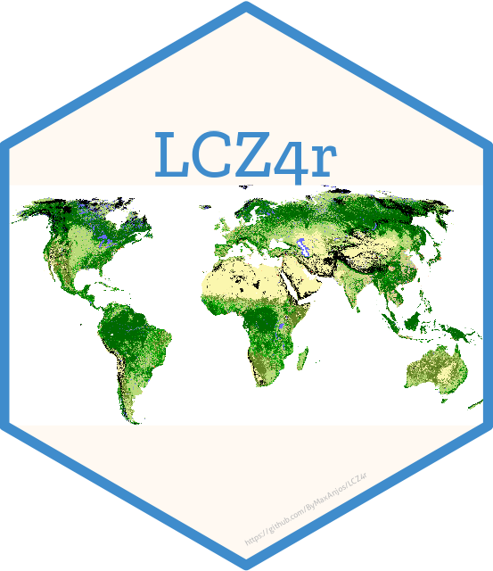

# Ferramentas para Análise de Zonas Climáticas Locais e Ilhas de Calor Urbanas em R


  
<!-- badges: start -->
[](https://lifecycle.r-lib.org/articles/stages.html#experimental)
<!-- badges: end -->

O [**pacote LCZ4r**](https://github.com/ByMaxAnjos/LCZ4r) oferece um conjunto abrangente de ferramentas para analisar e visualizar **Zonas Climáticas Locais (LCZ)** e **Ilhas de Calor Urbanas (UHI)** no R. Projetado para pesquisadores, planejadores urbanos e cientistas do clima, o LCZ4r simplifica o processo de download, processamento e interpretação de dados de LCZ.

---

# 0. Novidades na 0.2.0

- **11 idiomas**: todas as funções aceitam `lang = "en"` (e `pt`, `es`, `fr`,
  `zh`, `de`, `it`, `ja`, `ko`, `ru`, `ar`).
- **Figuras prontas para publicação**: `lcz_theme_journal()` e
  `lcz_save_figure()` geram figuras de 120/190 mm a 600 dpi ou PDF/SVG vetorial.
- **ICU sem eixo duplo**: `group = TRUE` agora desenha dois painéis alinhados,
  (a) temperatura urbana/rural e (b) intensidade da ICU.
- **Muito mais rápido**: `lcz_get_parameters()` ~83×, extração `two.step` ~16×,
  mapa ~3,6×.
- **Diagnóstico claro** quando as estações não coincidem com o mapa LCZ.
- **Terminologia LCZ revisada** com nomenclaturas nacionais publicadas.

# 0.1 Idiomas

Todas as funções exportadas aceitam o argumento `lang`. Mensagens, erros,
rótulos de eixo, legendas e os nomes das 17 classes LCZ são traduzidos para
**11 idiomas**: `en` (padrão), `pt`, `es`, `fr`, `zh`, `de`, `it`, `ja`, `ko`,
`ru`, `ar`.

```r
library(LCZ4r)

lcz_langs()                     # idiomas disponíveis
lcz_set_lang("pt")              # padrão da sessão

meu_mapa <- lcz_get_map(city = "Juiz de Fora", lang = "pt")
lcz_plot_map(meu_mapa, lang = "pt", title = "Zonas Climáticas Locais")
lcz_cal_area(meu_mapa, lang = "pt")
```

Códigos regionais são aceitos (`pt-BR`, `zh-Hans`, `es-419`). Um código inválido
cai para o inglês com um único aviso, sem interromper a análise.

---

# 0.2 Figuras prontas para publicação

Mapas e gráficos compartilham um único sistema editorial: títulos à esquerda,
sem molduras superior/direita, paletas seguras para daltonismo e legenda LCZ em
uma coluna para o mapa manter sua área.

| Elemento | Padrão |
|---|---|
| Largura | 120 mm (uma coluna) / 190 mm (duas) |
| Texto | 11 pt no tamanho de desenho |
| Raster | 600 dpi (PNG/TIFF) |
| Vetor | PDF (cairo) ou SVG |
| Legenda LCZ | 1 coluna (`legend_ncol = 2` opcional) |
| Escala contínua | viridis / magma |
| Anomalia | azul–branco–vermelho simétrica |

```r
library(LCZ4r)

meu_mapa <- lcz_get_map(city = "Berlin", lang = "pt")

p <- lcz_plot_map(meu_mapa, lang = "pt", title = "Zonas Climáticas Locais",
                  scalebar = TRUE, north_arrow = TRUE)
lcz_save_figure(p, "fig_mapa.pdf", width = "double", height = 150)

data(lcz_data)
p_uhi <- lcz_uhi_intensity(meu_mapa, lcz_data, var = "airT",
                           station_id = "station", group = TRUE, lang = "pt")
lcz_save_figure(p_uhi, "fig_icu.pdf", width = "double", height = 165)
```

Para a coluna estrita de 89 mm, use largura numérica:

```r
lcz_save_figure(p, "fig_mapa_89mm.pdf", width = 89, height = 110)
```

A especificação completa está em `dev/design-system.md`.

---

# 1. Instalação

O pacote `LCZ4r` está disponível no GitHub e pode ser instalado de duas maneiras.  
Recomendamos a **Opção 1** para a maioria dos usuários.

## Opção 1: Instalar a partir do GitHub (Recomendado)

Esta é a maneira mais rápida de obter a versão mais recente do pacote.

::: callout-tip
**Pré-requisito:** Se você já possui os pacotes `remotes` ou `devtools` instalados, pode pular esta etapa.
:::

```r
# Instalar pelo R-universe (recomendado, não precisa de token do GitHub)
install.packages("LCZ4r", repos = c("https://bymaxanjos.r-universe.dev", "https://cloud.r-project.org"))

# Ou instalar diretamente do GitHub
if (!require("remotes")) { install.packages("remotes")}
remotes::install_github("ByMaxAnjos/LCZ4r", upgrade = "never")
```

::: callout-warning
Atualizações: O `LCZ4r` está em desenvolvimento ativo. Para atualizar, basta executar novamente o comando acima.
O R substituirá automaticamente a versão anterior. Após a atualização, é recomendado reiniciar a sessão do R
(Sessão > Reiniciar R).
:::

## Opção 2: Instalar a partir de Arquivo Local (.zip)

Esta opção é recomendada para: conexões de internet instáveis, redes restritas (ex.: ambientes institucionais) e sessões de treinamento com múltiplos usuários.

Passos:

1. **Baixar o pacote**
👉 https://github.com/ByMaxAnjos/LCZ4r/archive/refs/heads/main.zip

2. **Extrair o arquivo**
👉 Após o download, extraia o arquivo .zip para uma pasta local (ex.: Downloads ou Área de Trabalho)

3. **Instalar localmente**

```r
# IMPORTANTE: Ajuste o caminho para onde você extraiu a pasta
remotes::install_local(
  "C:/Caminho/para/sua/pasta/LCZ4r-main", 
  upgrade = "never"
)
```

::: callout-tip
Exemplo: Se você baixou e extraiu o arquivo para a pasta Downloads:

```r
remotes::install_local(
   "/Users/maxanjos/Downloads/LCZ4r-main",
  upgrade = "never"
)
```
:::

## Carregando o pacote

Após a instalação, carregue o pacote sempre que iniciar uma nova sessão do R:

```r
library(LCZ4r)
```

---

## [Execute o LCZ4r no Posit Cloud, sem necessidade de instalar o RStudio!](https://bymaxanjos.github.io/LCZ4r/en/articles/posit_cloud.html)

<a href="https://posit.cloud/content/9921467" target="_blank">
  <p style="text-align:center;">
    
  </p>
  <p style="text-align:center;">
    (Clique na imagem para explorar o LCZ4r no Posit Cloud.)
  </p>
</a>

---

## Inspiração

O pacote **LCZ4r** é inspirado nos seguintes trabalhos:

- **Stewart, I., and T. Oke, 2012**: [Local Climate Zones for Urban Temperature Studies](https://doi.org/10.1175/BAMS-D-11-00019.1).

- **Ching, J., et al., 2018**: [WUDAPT: An Urban Weather, Climate, and Environmental Modeling Infrastructure for the Anthropocene](https://doi.org/10.1175/BAMS-D-16-0236.1).
- **Demuzere, M., et al., 2019**: [Mapping Europe into Local Climate Zones](https://doi.org/10.1371/journal.pone.0214474).
- **Demuzere, M., et al., 2020**: [Combining Expert and Crowd-Sourced Training Data to Map Urban Form and Functions for the Continental US](https://doi.org/10.1038/s41597-020-00605-z).
- **Demuzere, M., et al., 2022**: [A Global Map of Local Climate Zones to Support Earth System Modelling and Urban-Scale Environmental Science](https://doi.org/10.5194/essd-14-3835-2022).

---

## Tem Comentários ou Sugestões?

Valorizamos sua contribuição! Se você tem ideias para melhorias ou encontrou algum problema, por favor, informe-nos abrindo uma issue no GitHub.

<button type="button" class="btn" style="background-color: #008000; color: white; padding: .5rem 1rem; font-size: 1rem; border: none; border-radius: .25rem;">
  <a href='https://github.com/ByMaxAnjos/LCZ4r/issues/new' style="text-decoration: none; color: white;">
    Abrir uma Issue no GitHub
  </a>
</button>
```

