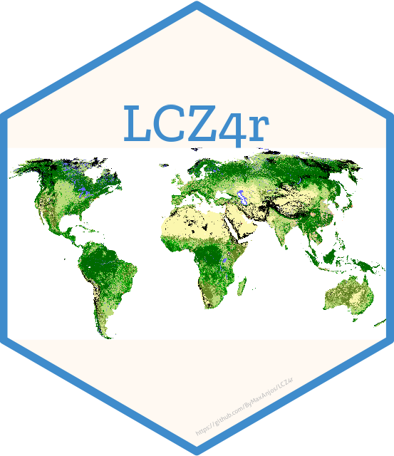

# R语言中的局地气候区与城市热岛分析工具


  
<!-- badges: start -->
[](https://lifecycle.r-lib.org/articles/stages.html#experimental)
<!-- badges: end -->

[**LCZ4r 包**](https://github.com/ByMaxAnjos/LCZ4r) 提供了一套全面的工具，用于在 R 语言环境中分析和可视化**局地气候区 (LCZ)** 和**城市热岛 (UHI)**。该工具包专为研究人员、城市规划师和气候科学家设计，简化了 LCZ 数据的下载、处理和解释过程。

---

# 0. 0.2.0 新功能

- **11 种语言**：所有导出函数均支持 `lang = "en"`（以及 `pt`、`es`、`fr`、
  `zh`、`de`、`it`、`ja`、`ko`、`ru`、`ar`）。
- **出版级图形**：`lcz_theme_journal()` 与 `lcz_save_figure()` 可输出
  120/190 mm、600 dpi 或 PDF/SVG 矢量图。
- **无双轴热岛图**：`group = TRUE` 现在绘制两个对齐面板：
  (a) 城市/乡村气温，(b) 热岛强度。
- **性能大幅提升**：`lcz_get_parameters()` 约 83×，`two.step` 约 16×。
- **清晰诊断**：站点与 LCZ 地图不匹配时给出明确提示。
- **LCZ 术语已按各国发表文献修订**。

# 0.1 语言

所有导出函数均接受 `lang` 参数。消息、错误、坐标轴标签、图例以及 17 个
LCZ 类别名称已翻译为 **11 种语言**：`en`（默认）、`pt`、`es`、`fr`、`zh`、
`de`、`it`、`ja`、`ko`、`ru`、`ar`。

# 0.2 出版级图形

所有地图和图表使用统一的编辑规范：标题左对齐、无上/右边框、色盲安全
配色，LCZ 图例默认单列以保留地图面积。

```r
library(LCZ4r)

my_map <- lcz_get_map(city = "Berlin", lang = "zh")

p <- lcz_plot_map(my_map, lang = "zh", title = "局地气候区",
                  scalebar = TRUE, north_arrow = TRUE)
lcz_save_figure(p, "fig_map.pdf", width = "double", height = 150)

data(lcz_data)
p_uhi <- lcz_uhi_intensity(my_map, lcz_data, var = "airT",
                           station_id = "station", group = TRUE, lang = "zh")
lcz_save_figure(p_uhi, "fig_uhi.pdf", width = "double", height = 165)
```

完整规范见 `dev/design-system.md`。

---

# 1. 安装说明

`LCZ4r` 包托管于 GitHub，可通过两种方式安装。  
对于大多数用户，我们推荐**方式一**。

## 方式一：从 GitHub 安装（推荐）

这是获取最新版本包的最快方式。

::: callout-tip
**前置要求：** 如果您已经安装了 `remotes` 或 `devtools` 包，可以跳过此步骤。
:::

```r
# 从 R-universe 安装(推荐,无需 GitHub 令牌)
install.packages("LCZ4r", repos = c("https://bymaxanjos.r-universe.dev", "https://cloud.r-project.org"))

# 或直接从 GitHub 安装
if (!require("remotes")) { install.packages("remotes")}
remotes::install_github("ByMaxAnjos/LCZ4r", upgrade = "never")
```

::: callout-warning
更新说明：`LCZ4r` 处于活跃开发阶段。如需更新，只需再次运行上述命令即可。
R 会自动覆盖之前的版本。更新后，建议重启 R 会话（会话 > 重启 R）。
:::

## 方式二：从本地文件安装 (.zip)

此方式适用于以下场景：网络连接不稳定、网络受限环境（如机构内网）、多人培训课程。

安装步骤：

1. **下载包文件**
👉 https://github.com/ByMaxAnjos/LCZ4r/archive/refs/heads/main.zip

2. **解压文件**
👉 下载完成后，将 .zip 文件解压到本地文件夹（例如：下载文件夹或桌面）

3. **本地安装**

```r
# 重要提示：请根据解压路径调整以下路径
remotes::install_local(
  "C:/您的文件夹路径/LCZ4r-main", 
  upgrade = "never"
)
```

::: callout-tip
示例：如果您将文件下载并解压到下载文件夹：

```r
remotes::install_local(
   "/Users/maxanjos/Downloads/LCZ4r-main",
  upgrade = "never"
)
```
:::

## 加载包

安装完成后，每次启动新的 R 会话时，加载该包：

```r
library(LCZ4r)
```

---

## [在 Posit Cloud 上运行 LCZ4r，无需安装 RStudio！](https://bymaxanjos.github.io/LCZ4r/zh/articles/posit_cloud.html)

<a href="https://posit.cloud/content/9921467" target="_blank">
  <p style="text-align:center;">
    
  </p>
  <p style="text-align:center;">
    （点击图片，在 Posit Cloud 上探索 LCZ4r。）
  </p>
</a>

---

## 灵感来源

**LCZ4r** 包的开发受到以下研究成果的启发：

- **Stewart, I., and T. Oke, 2012**: [Local Climate Zones for Urban Temperature Studies](https://doi.org/10.1175/BAMS-D-11-00019.1).

- **Ching, J., et al., 2018**: [WUDAPT: An Urban Weather, Climate, and Environmental Modeling Infrastructure for the Anthropocene](https://doi.org/10.1175/BAMS-D-16-0236.1).
- **Demuzere, M., et al., 2019**: [Mapping Europe into Local Climate Zones](https://doi.org/10.1371/journal.pone.0214474).
- **Demuzere, M., et al., 2020**: [Combining Expert and Crowd-Sourced Training Data to Map Urban Form and Functions for the Continental US](https://doi.org/10.1038/s41597-020-00605-z).
- **Demuzere, M., et al., 2022**: [A Global Map of Local Climate Zones to Support Earth System Modelling and Urban-Scale Environmental Science](https://doi.org/10.5194/essd-14-3835-2022).

---

## 有反馈或建议？

我们非常重视您的意见！如果您有改进建议或发现任何问题，请在 GitHub 上提交 issue 告知我们。

<button type="button" class="btn" style="background-color: #008000; color: white; padding: .5rem 1rem; font-size: 1rem; border: none; border-radius: .25rem;">
  <a href='https://github.com/ByMaxAnjos/LCZ4r/issues/new' style="text-decoration: none; color: white;">
    在 GitHub 上提交 Issue
  </a>
</button>
```
